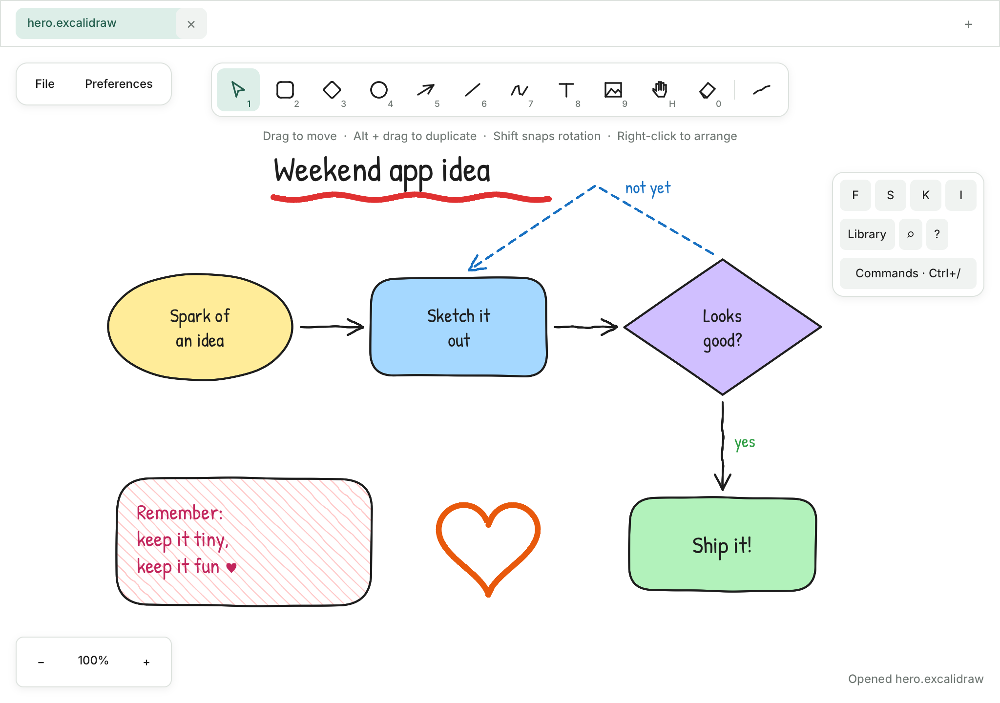
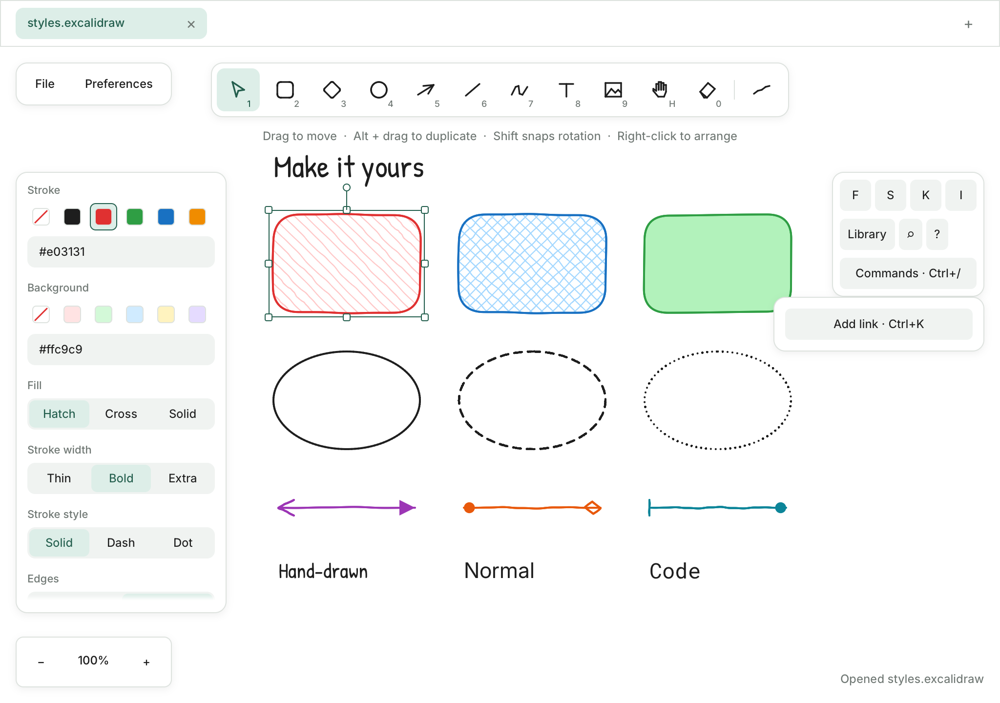
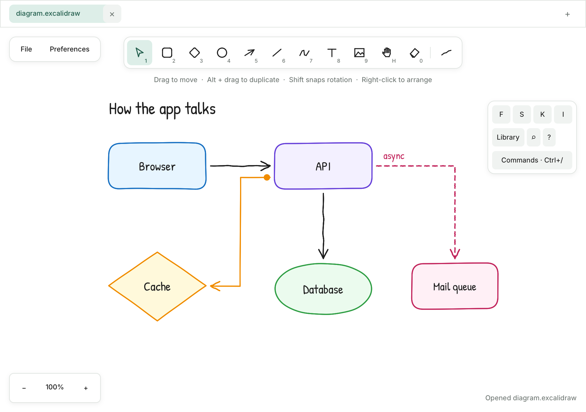
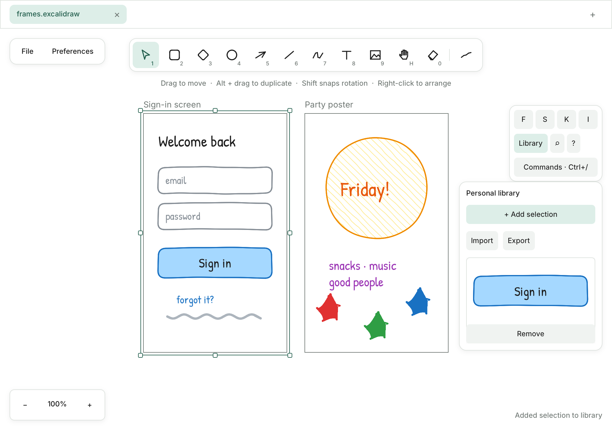
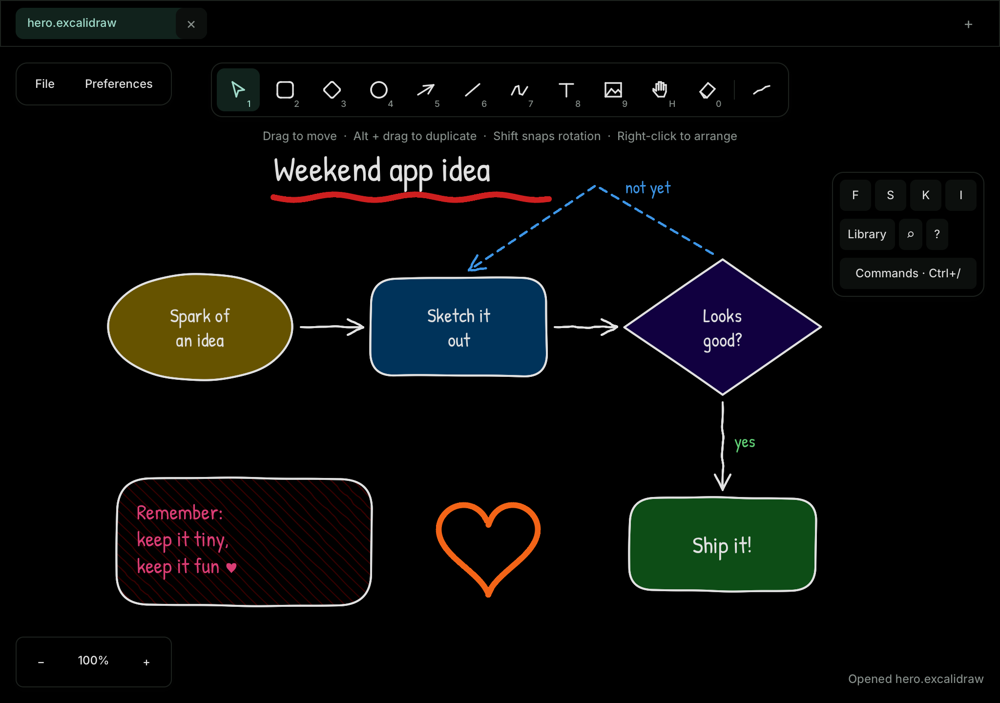
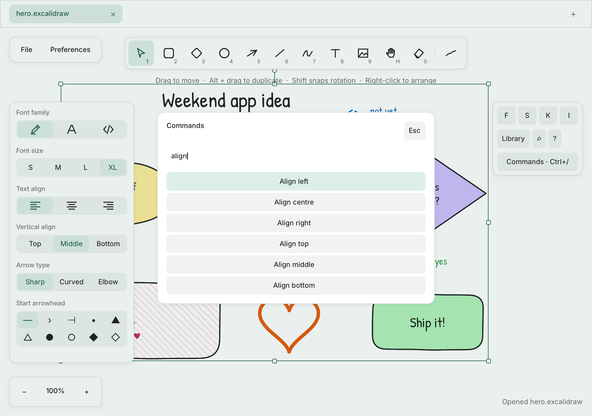

<div align="center">


# rusty-pencil

**A cosy, hand-drawn whiteboard that lives on your machine.**

Sketch ideas, map out systems and doodle in the margins. No account, no cloud, no waiting.
Just you, a blank canvas and a pen that feels like paper.

**[Try it in your browser](https://johndeezimmermann.github.io/rusty-pencil/)** (needs a WebGPU browser such as current Chrome or Edge)



</div>

## Why you'll like it

rusty-pencil is a native whiteboard written in Rust, in the spirit of Excalidraw. Every stroke
comes out slightly imperfect on purpose, so your diagrams look like something you scribbled
on a napkin (only much tidier). It runs on the GPU, so it opens fast and stays smooth while
you pan, zoom and drag.

- **Local first.** Your drawings never leave your computer. There is no server and no sign-up.
- **Feels instant.** Shapes follow your pointer on the very same frame, at any zoom level.
- **Never lose work.** Every tab autosaves quietly and comes back exactly as you left it.
- **Plays nicely.** Open your existing `.excalidraw` files and export crisp PNG or SVG.

## Draw anything, in your own style

Rectangles, diamonds, ellipses, arrows, lines, freehand ink, text and images are all one
keypress away (`1` to `9`). Then make them yours: pick a palette colour or type any hex
value, choose hatched, cross-hatched or solid fills, and dial the strokes from neat to
delightfully sloppy. Three fonts cover handwriting, clean labels and code.

<div align="center">

</div>

Change one element or fifty at once. A mixed selection simply says *Mixed*, and every edit
lands as a single, undoable step.

## Diagrams that hold together

Arrows snap to shapes and stay attached as you move things around. Switch an arrow to
**elbow** mode for tidy right-angled routes, or let it curve. Double-click any shape to write
inside it, and the shape grows to fit your words. Labels on arrows travel with them, too.

<div align="center">

</div>

Turn on the grid (`Ctrl+'`) or object snapping (`Alt+S`) when you want everything to line
up, with guides that appear right as you drag.

## Frames and a library of favourites

**Frames** turn a corner of the canvas into a storyboard panel, a slide or a screen mockup.
They clip what's inside, move their contents as one and export at their exact size. Anything
you draw often (a button, a server icon, a signature doodle) can go into your **personal
library**, ready to drag back onto any canvas.

<div align="center">

</div>

## Lights off

One shortcut (`Alt+Shift+D`) flips the whole editor into a calm dark mode. Your colours are
adapted automatically, so a drawing made in daylight still reads beautifully at midnight.

<div align="center">

</div>

## Keyboard-friendly to the core

Press `Ctrl+/` to open the command palette and reach any action by typing a few letters.
Press `?` for a cheat sheet of every shortcut. Hold your hands on the keys and the mouse
becomes optional.

<div align="center">

</div>

## All the little extras

A few more things tucked into rusty-pencil that make day-to-day sketching nicer:

| Feature | What it does |
|---|---|
| **Tabs** | Keep several canvases open, each with its own undo history and camera |
| **Lasso and eraser** | Select freeform areas (`S`) or rub things out (`0`) |
| **Laser pointer** | Point at things during a call with a fading trail (`K`) |
| **Eye-dropper** | Sample any colour from the canvas (`I`) |
| **Find** | Jump to any text or frame by name (`Ctrl+F`) |
| **Links** | Attach web links or jump-to-element links to shapes (`Ctrl+K`) |
| **Zen and View mode** | Hide the chrome to focus (`Alt+Z`), or present read-only (`Alt+R`) |
| **Export** | PNG or SVG at 1×, 2× or 3×, whole canvas, a selection or a single frame |

## Get started

You need a Rust toolchain; the exact version is pinned in `rust-toolchain.toml`, so `rustup`
picks it up for you. Then run:

```sh
git clone https://github.com/JohnDeeZimmermann/rusty-pencil.git
cd rusty-pencil
cargo run --release -p rusty-pencil
```

That's it. Grab the rectangle (`2`), drag on the canvas, and you're drawing. Drawings save as
`.rusty-pencil` files (`Ctrl+S`), which are plain, versioned JSON.

### In the browser

The same app also runs as a static WebAssembly page in any WebGPU browser, keeping your
drawings in browser storage. The latest `main` is always live at
[johndeezimmermann.github.io/rusty-pencil/](https://johndeezimmermann.github.io/rusty-pencil/). To build and serve it yourself:

```sh
app/rusty-pencil/web/build.sh
python3 -m http.server 8000 -d target/web   # then open http://localhost:8000
```

[docs/web.md](docs/web.md) covers prerequisites, supported browsers and what differs from the
desktop app.

## Learn more

- [The full guide](docs/guide.md) walks through every feature and shortcut.
- [The web build](docs/web.md) explains running rusty-pencil in a browser.
- [DESIGN.md](DESIGN.md) describes the look and feel of the interface.
- [EXCALIDRAW.md](EXCALIDRAW.md) tracks feature parity with Excalidraw.
- [milestones/](milestones/README.md) shows how the app was built, step by step.

Curious how it works inside? The [AGENTS.md](AGENTS.md) file explains the crate layout and
the principles every change is judged against: beautiful visuals first, then smooth
interactions, high performance and polish.

<div align="center">
<sub>Made with Rust and a fondness for wobbly lines. Created in <a href="https://t3.codes">T3 Code</a>.</sub>
</div>
